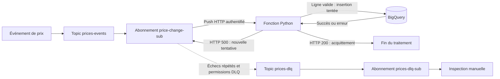

# Pub/Sub : diagnostiquer les messages en échec et leur transfert en DLQ

Un pipeline reçoit des événements de changement de prix via Pub/Sub, les traite dans une fonction Python et tente de les insérer dans BigQuery. Pendant l'exercice, des messages échouaient et n'atteignaient pas la file d'erreurs attendue. Le diagnostic a porté sur le contenu des événements et les permissions des différents comptes de service.

**Résultat historique :** les journaux d'audit confirment l'attribution des permissions DLQ au service agent Pub/Sub. La réception finale de deux messages a été rapportée à l'issue de l'exercice ; la sortie terminal originale n'a pas été retrouvée. Une insertion réussie dans BigQuery et un rejeu des messages ne sont pas démontrés par les pièces conservées.

## Ma contribution

J'ai reproduit la configuration et les tests du support de formation, inspecté les journaux et participé au diagnostic des échecs. Avec assistance, j'ai corrigé les permissions du service agent Pub/Sub pour permettre le transfert vers la DLQ. Ce dépôt formalise cette démarche et ses limites.

## Architecture



Le filtre porte sur l'attribut Pub/Sub `event_type`, pas sur le champ homonyme dans le JSON. La DLQ est configurée sur l'abonnement source. Le seuil de cinq livraisons est approximatif : il ne garantit pas exactement cinq retries. [Fonctionnement de la DLQ](https://docs.cloud.google.com/pubsub/docs/dead-letter-topics).

## Ce que le diagnostic a permis de distinguer

| Symptôme | Interprétation | Action |
|---|---|---|
| `old_price` absent, HTTP 500 | Le message ne respecte pas le contrat attendu | Examiner le contenu et les champs obligatoires |
| BigQuery 403 `bigquery.tables.updateData` | L'insertion atteint BigQuery, qui refuse l'accès | Vérifier les droits du compte d'exécution de la fonction |
| Messages en échec non retrouvés en DLQ | Examiner la policy et les droits de transfert | Subscriber sur la source et Publisher sur la DLQ pour le service agent Pub/Sub |

Le dernier diagnostic est soutenu par le récit de l'exercice et les attributions IAM réussies. Ces attributions ne prouvent pas à elles seules l'absence préalable de droits hérités. La [chronologie et les preuves](docs/case-study.md) détaillent les observations.

## Exécuter localement

Python 3.11 ou plus récent suffit. Depuis la racine du dépôt :

```bash
python3 -m unittest discover -s tests -v
python3 demo.py
```

La démo utilise un faux client BigQuery et deux événements synthétiques. Elle affiche une insertion simulée avec HTTP 200, puis un rejet avec HTTP 500. Elle ne simule ni le service Pub/Sub, ni ses retries, ni un transfert réel en DLQ.

**Validation locale du 25 octobre 2026 : 13 tests réussis sous Python 3.11 et 3.12.** Voir le [bilan de validation](docs/validation.md). Les mêmes tests et la démo ont aussi réussi sur GitHub Actions : [exécution du 25 octobre 2026](https://github.com/MididouNueve/gcp-pubsub-dead-letter-recovery/actions/runs/40225076102).

## Lire le dépôt

| Fichier | Utilité |
|---|---|
| [Étude de cas](docs/case-study.md) | Chronologie, observations et limites des preuves |
| [Identités et permissions](docs/iam.md) | Distinguer service agent, compte de push et compte d'exécution |
| [Guide cloud](docs/cloud-lab.md) | Commandes pour une future reproduction dans un projet de test |
| [Plan de vérification](docs/verification.md) | Critères de succès et traces à conserver |
| [Transcription historique](historical/main.py) | Code visible dans la capture, conservé séparément |
| [Traitement local](price_events.py) et [adaptateur HTTP](main.py) | Reproduction adaptée et testable |
| [Exemples](examples/valid-event.json) | Données synthétiques, sans identifiants personnels |

## Portée de la reproduction

La version actuelle valide explicitement les champs, refuse les prix non finis et exige un timestamp avec fuseau horaire. Elle utilise un identifiant de table complet et conserve le `messageId` comme identifiant d'insertion stable. La déduplication `insertAll` reste best effort : ce n'est pas une garantie d'exécution unique. [API BigQuery](https://docs.cloud.google.com/bigquery/docs/reference/rest/v2/tabledata/insertAll).

Les erreurs de contenu renvoient volontairement HTTP 500 pour conserver le parcours pédagogique retry → DLQ ; elles ne sont pas corrigées par les retries. Un HTTP 200 n'est renvoyé qu'après une insertion sans erreur signalée. [Acquittement du push](https://docs.cloud.google.com/pubsub/docs/push).

Les tests locaux utilisent un client BigQuery substitué. Ils ne valident pas IAM, OIDC, la facturation, le déploiement, les délais de retry ou la livraison en DLQ. Le guide cloud n'a pas été exécuté pour préparer ce dépôt. Les dépendances cloud sont bornées par version majeure mais ne constituent pas un environnement verrouillé.

Les captures brutes et exports de compte sont conservés hors du dépôt. Voir la [provenance](historical/README.md).
